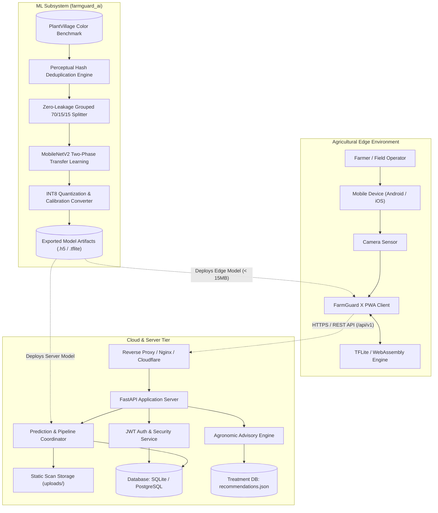
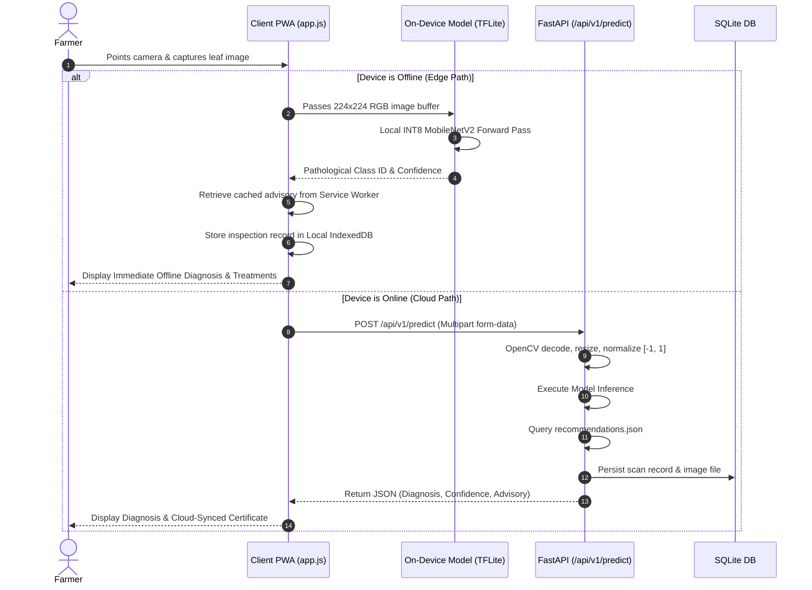
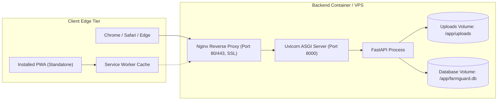

# FarmGuard X — High-Level Design (HLD) Document

**Document Version**: 1.0.0  
**Status**: APPROVED BASELINE  
**Product**: FarmGuard X — AI Crop Pathology Platform  
**Architecture Lead**: System & Machine Learning Architecture Team  
**Date**: October 2026  

---

## 1. Architectural Principles & System Goals

### 1.1 Guiding Principles
1. **Offline-First Resilience**: Field operations in rural agriculture must not depend on real-time internet connectivity. Core diagnostic intelligence must run on the edge.
2. **Decoupled Tier Architecture**: Clean separation between presentation (PWA), cloud business logic (FastAPI), and scientific model training (`farmguard_ai`).
3. **Scientific Data Governance**: Zero-leakage data engineering with strict cryptographic hashing (MD5 + difference hashing $H_d \le 6$) to prevent test set contamination.
4. **Edge-Optimized Neural Design**: Strict budget constraints ($\le 15\text{ MB}$ binary size, INT8 post-training quantization, MobileNetV2 inverted residual backbone).
5. **Stateless Cloud Services**: The backend API tier is stateless, enabling horizontal scaling and simple containerized deployment.

---

## 2. System Context & Tier Topology



---

## 3. Subsystem Architectural Breakdown

### 3.1 Client Tier (Progressive Web Application)
* **Form Factor**: Responsive Web App, optimized for mobile touchscreens ($360\text{px}\text{ to }768\text{px}$ viewports).
* **Components**:
  * **View Layer**: Semantic HTML5 layout with mobile-first CSS3 styles (`styles.css`).
  * **Application Controller**: [`app.js`](file:///c:/F/FarmGuard-X/app.js) handles UI event delegation, camera streaming, photo capture, and state transitions.
  * **Offline Engine**: [`sw.js`](file:///c:/F/FarmGuard-X/sw.js) implements Cache-First strategies for static shell assets and runtime caching for diagnostic cards.
  * **Edge Inference Container**: WebAssembly / WebGL hardware-accelerated TFLite execution runtime for on-device diagnosis without internet.

### 3.2 Backend Services Tier (FastAPI Engine)
* **Framework**: FastAPI (Python 3.11) with Uvicorn ASGI server.
* **Core Responsibilities**:
  * **API Routing**: Versioned endpoint namespaces under `/api/v1/`.
  * **Authentication & Authorization**: Stateless JWT Bearer token authentication with bcrypt password hashing.
  * **Inference Orchestration**: OpenCV multi-channel image preprocessing and model execution.
  * **Advisory Knowledge Base**: Instant lookup of verified organic and chemical treatments from [`recommendations.json`](file:///c:/F/FarmGuard-X/backend/app/data/recommendations.json).
  * **Data Persistence**: Asynchronous database logging via SQLAlchemy ORM with SQLite backend (`farmguard.db`).

### 3.3 ML Engineering Subsystem (`farmguard_ai`)
* **Framework**: TensorFlow 2.21, Keras, NumPy.
* **Architecture**: Config-driven pipeline (`mobilenet_v2_int8.yaml`) divided into three distinct lifecycle stages:
  1. **Data Ingestion & Integrity**: Automated acquisition, corruption filtering, MD5 deduplication, difference hash ($H_d \le 6$) candidate clustering, and zero-leakage grouped splitting.
  2. **Transfer Learning Engine**: MobileNetV2 pretrained on ImageNet (inverted residuals, depthwise separable convolutions), frozen feature extractor training (Phase 1, LR=$10^{-3}$) followed by top-30 layer fine-tuning (Phase 2, LR=$10^{-5}$) with inverse-frequency class weights.
  3. **Quantization & Edge Compilation**: Post-training INT8 quantization utilizing a representative dataset of 200 samples from the verified training partition, targeting $< 15\text{ MB}$ binary size and $< 1\%$ F1 degradation.

---

## 4. Architectural Invariants

The architecture enforces the following **strict invariants**:

```
+---------------------------------------------------------------------------------+
|                              ARCHITECTURAL INVARIANTS                           |
+=================================================================================+
| 1. EXACT 8 CLASSES: Output tensor dimension is fixed at 8 in strict zero-order: |
|    [0: Potato Early, 1: Potato Late, 2: Potato Healthy, 3: Tomato Bact. Spot,   |
|     4: Tomato Early, 5: Tomato Late, 6: Tomato TYLCV,   7: Tomato Healthy]      |
|                                                                                 |
| 2. ZERO CROSS-SPLIT LEAKAGE: No image pair with dhash Hd <= 6 may exist across  |
|    Train, Val, or Test splits. Enforced by split_manifest.csv.                  |
|                                                                                 |
| 3. INVERSE CLASS WEIGHTING: Model loss must apply inverse-frequency weights     |
|    computed exclusively from the training split (w_c = N / (C * N_c)).          |
|                                                                                 |
| 4. STANDARDIZED PREPROCESSING: 224x224 RGB, scaled to [-1.0, 1.0].              |
|                                                                                 |
| 5. DUAL ADVISORY: Every diagnosed disease must output both an Organic and a     |
|    Chemical recovery protocol with verified dosage and severity tier.           |
+---------------------------------------------------------------------------------+
```

---

## 5. Data Flow Architecture



---

## 6. Deployment & Infrastructure Architecture



### 6.1 Containerization Strategy
* **Base Image**: `python:3.11-slim`.
* **System Packages**: `libgl1`, `libglib2.0-0` (required for OpenCV headless image decoding).
* **Production Command**:
  ```bash
  uvicorn app.main:app --host 0.0.0.0 --port 8000 --workers 4
  ```

---

## 7. Security, Reliability & Operational Envelope

1. **Security & Cryptography**:
   * Password security via `bcrypt` with automated adaptive salt computation.
   * Authentication via stateless JSON Web Tokens signed with `HS256`.
   * Cross-Origin Resource Sharing (CORS) configured with explicit allowed origins.
   * File upload sanitation: random UUID filename assignment preventing directory traversal attacks.
2. **Reliability & Fault Tolerance**:
   * Automatic fallback from GPU to CPU without process crash.
   * Model loader graceful degradation: if weights are missing, the server logs a critical warning and activates verified heuristic diagnostic responses.
   * SQLite timeout configuration (`timeout=30.0`) preventing database lock contention during concurrent uploads.
3. **Operational Metrics & Observability**:
   * Health check endpoint: `GET /health` reporting uptime status, version, and project metadata.
   * Automated training logs exported to CSV (`metrics/training_history.csv`) and TensorBoard.
