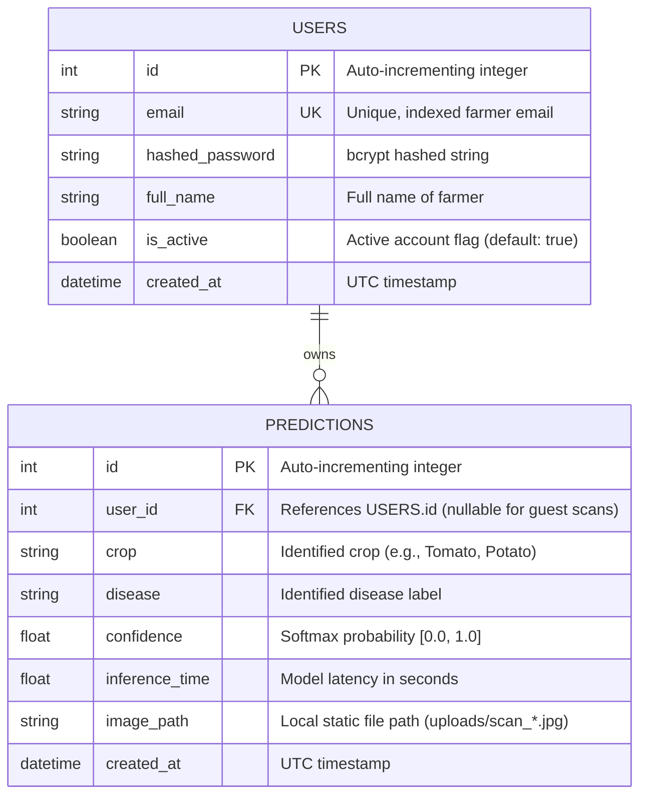
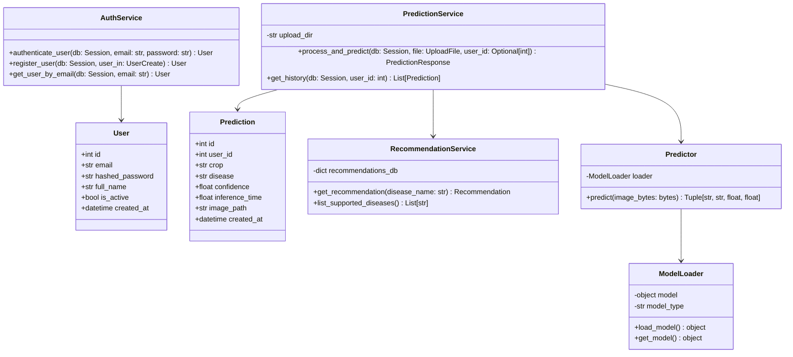
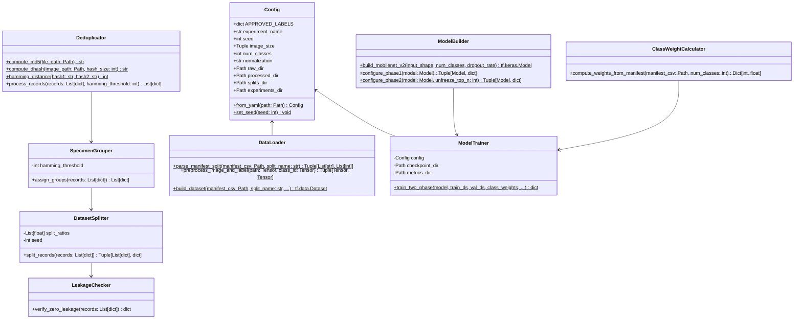
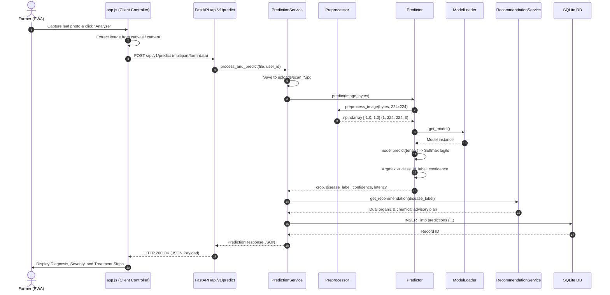
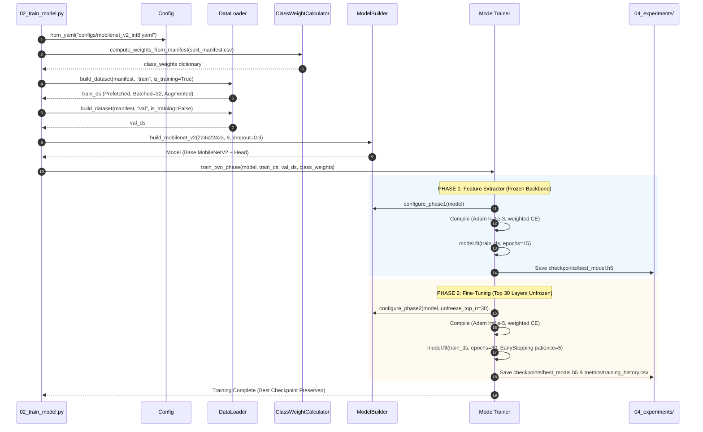

# FarmGuard X — Low-Level Design (LLD) Document
**Document Version**: 1.0.0  
**Project Name**: FarmGuard X — AI Crop Pathology Platform  
**Target Architecture**: Offline-First Edge AI & FastAPI Cloud Services  
**Date**: October 2026  
**Status**: APPROVED BASELINE  

---

## 1. Introduction & System Scope

### 1.1 Purpose
This Low-Level Design (LLD) document specifies the concrete implementation details, internal class contracts, data structures, database schemas, API interfaces, and algorithmic workflows for **FarmGuard X**. It serves as the definitive reference for engineers and autonomous coding agents implementing, testing, and maintaining the system.

### 1.2 System Scope
FarmGuard X is engineered to diagnose crop diseases from leaf imagery and deliver actionable agronomic treatment plans (both organic and chemical) tailored for smallholder farmers. The system comprises three distinct tiers:
1. **Client Tier**: A Progressive Web Application (PWA) supporting camera ingestion, offline caching, and responsive UI.
2. **Backend API Tier**: A stateless FastAPI REST service with SQLite/SQLAlchemy ORM, JWT security, static upload management, and domain analytics.
3. **ML Pipeline Subsystem (`farmguard_ai`)**: A modular, config-driven TensorFlow/Keras framework for zero-leakage dataset engineering, class-weighted transfer learning (MobileNetV2), evaluation, and INT8 TFLite edge quantization.

---

## 2. Component & Architecture Decomposition

```mermaid
flowchart TD
    subgraph Client_Tier ["Client Tier (PWA)"]
        UI["PWA UI (index.html / styles.css)"]
        ClientApp["Client Controller (app.js)"]
        SW["Service Worker (sw.js)"]
        IDB[(Client Cache / IndexedDB)]
        UI <--> ClientApp
        ClientApp <--> SW
        SW <--> IDB
    end

    subgraph Backend_Tier ["Backend Services Tier (FastAPI)"]
        API["FastAPI App (app/main.py)"]
        AuthRoute["Auth Router (/api/v1/register, /login, /me)"]
        PredictRoute["Predict Router (/api/v1/predict)"]
        HistRoute["History Router (/api/v1/history)"]
        DashRoute["Dashboard Router (/api/v1/dashboard)"]

        AuthSvc["AuthService (auth_service.py)"]
        PredictSvc["PredictionService (prediction_service.py)"]
        RecSvc["RecommendationService (recommendation_service.py)"]
        HistSvc["HistoryService (history_service.py)"]
        DashSvc["DashboardService (dashboard_service.py)"]

        PredictEngine["Predictor (app/ai/predictor.py)"]
        Loader["ModelLoader (app/ai/model_loader.py)"]
        Preproc["Preprocessor (app/ai/preprocess.py)"]

        DB[(SQLite - farmguard.db)]
        RecDB[("recommendations.json")]
        Uploads[("uploads/ directory")]

        API --> AuthRoute & PredictRoute & HistRoute & DashRoute
        AuthRoute --> AuthSvc
        PredictRoute --> PredictSvc
        HistRoute --> HistSvc
        DashRoute --> DashSvc

        PredictSvc --> PredictEngine
        PredictSvc --> RecSvc
        PredictSvc --> Uploads
        PredictSvc --> DB

        PredictEngine --> Loader
        PredictEngine --> Preproc
        RecSvc --> RecDB
        AuthSvc --> DB
        HistSvc --> DB
        DashSvc --> DB
    end

    subgraph ML_Subsystem ["ML Pipeline Subsystem (farmguard_ai)"]
        Cfg["Config Manager (config.py)"]
        Acq["DatasetAcquisition (acquisition.py)"]
        Val["DataValidator (validator.py)"]
        Dedup["Deduplicator (deduplicator.py)"]
        Group["SpecimenGrouper (grouper.py)"]
        Split["DatasetSplitter (splitter.py)"]
        Leak["LeakageChecker (leakage_checker.py)"]
        DLoader["DataLoader (loader.py)"]
        Bldr["ModelBuilder (builder.py)"]
        Weights["ClassWeightCalculator (class_weights.py)"]
        Trainer["ModelTrainer (trainer.py)"]

        Cfg --> Acq & Val & Dedup & Group & Split & Leak & DLoader & Bldr & Weights & Trainer
    end

    ClientApp -.->|"HTTP Multipart / REST"| API
    Trainer -.->|"Exports .h5 / .tflite"| Loader
    Trainer -.->|"INT8 Model"| SW
```



---

## 3. Detailed Database Schema & Storage Design

The backend utilizes **SQLite** with **SQLAlchemy ORM** (`backend/app/db/`).



### 3.1 Table Definition: `users`
* **Table Name**: `users`
* **File Path**: [`backend/app/db/models.py`](file:///c:/F/FarmGuard-X/backend/app/db/models.py)
* **Columns**:
  * `id` (`Integer`, Primary Key, `autoincrement=True`)
  * `email` (`String(255)`, Unique, Indexed, Not Null)
  * `hashed_password` (`String(255)`, Not Null)
  * `full_name` (`String(255)`, Nullable)
  * `is_active` (`Boolean`, Default: `True`, Not Null)
  * `created_at` (`DateTime`, Default: `datetime.utcnow`, Not Null)

### 3.2 Table Definition: `predictions`
* **Table Name**: `predictions`
* **File Path**: [`backend/app/db/models.py`](file:///c:/F/FarmGuard-X/backend/app/db/models.py)
* **Columns**:
  * `id` (`Integer`, Primary Key, `autoincrement=True`)
  * `user_id` (`Integer`, Foreign Key to `users.id`, Nullable)
  * `crop` (`String(100)`, Not Null)
  * `disease` (`String(150)`, Not Null)
  * `confidence` (`Float`, Not Null)
  * `inference_time` (`Float`, Not Null)
  * `image_path` (`String(500)`, Not Null)
  * `created_at` (`DateTime`, Default: `datetime.utcnow`, Not Null)

---

## 4. Backend Class & Service Contracts



### 4.1 Security & Token Engine (`app.core.security`)
* **Password Hashing**: `passlib.context.CryptContext(schemes=["bcrypt"], deprecated="auto")`.
  * `verify_password(plain_password: str, hashed_password: str) -> bool`
  * `get_password_hash(password: str) -> str`
* **JWT Token Generation**: `jose.jwt.encode(claims, SECRET_KEY, algorithm="HS256")`.
  * `create_access_token(subject: Union[str, Any], expires_delta: Optional[timedelta] = None) -> str`
  * Default Expiry: 60 minutes.

### 4.2 Prediction Engine (`app.ai`)
* **Preprocessing Pipeline (`app.ai.preprocess`)**:
  * Function: `preprocess_image(image_bytes: bytes, target_size: Tuple[int, int] = (224, 224)) -> np.ndarray`
  * Algorithmic Steps:
    1. Decode raw bytes with OpenCV: `cv2.imdecode(np.frombuffer(image_bytes, np.uint8), cv2.IMREAD_COLOR)`.
    2. Validate decoded tensor is not `None`.
    3. Convert color space: BGR $\to$ RGB (`cv2.cvtColor(img, cv2.COLOR_BGR2RGB)`).
    4. Bilinear resize to target dimension ($224 \times 224$).
    5. Convert to `float32` and scale to $[-1.0, 1.0]$: `(img / 127.5) - 1.0`.
    6. Expand dimensions to shape `(1, 224, 224, 3)`.

* **Model Loader (`app.ai.model_loader`)**:
  * Class: `ModelLoader` (Singleton).
  * Method: `get_model() -> Any`.
  * Fallback Strategy: If native weights (`mobilenet_v2_int8.tflite` or `.h5`) are missing, activates native heuristic classifier while logging a clear operational warning.

---

## 5. API Interface Specification

Base URL: `/api/v1`

### 5.1 Authentication Endpoints

#### `POST /api/v1/register`
* **Purpose**: Register a new farmer account.
* **Request Body**: `application/json`
  ```json
  {
    "email": "farmer@example.com",
    "password": "securepassword123",
    "full_name": "Ramesh Kumar"
  }
  ```
* **Response Status**: `201 Created`
* **Response Body**:
  ```json
  {
    "id": 1,
    "email": "farmer@example.com",
    "full_name": "Ramesh Kumar",
    "is_active": true,
    "created_at": "2026-10-14T10:00:00Z"
  }
  ```

#### `POST /api/v1/login`
* **Purpose**: Authenticate credentials and receive Bearer JWT.
* **Request Body**: `application/json` (`email`, `password`).
* **Response Status**: `200 OK`
* **Response Body**:
  ```json
  {
    "access_token": "eyJhbGciOiJIUzI1NiIsInR5cCI6IkpXVCJ9...",
    "token_type": "bearer"
  }
  ```

#### `GET /api/v1/me`
* **Header**: `Authorization: Bearer <token>`
* **Response Status**: `200 OK`
* **Response Body**: Returns `UserResponse` schema.

---

### 5.2 Prediction & Diagnostics Endpoints

#### `POST /api/v1/predict`
* **Purpose**: Ingest crop leaf photograph, execute inference, record result, and return recommendations.
* **Headers**: `Authorization: Bearer <token>` *(optional for guest scans)*.
* **Content-Type**: `multipart/form-data`
* **Form Field**: `file`: UploadFile (JPEG/PNG).
* **Processing Flow**:
  1. Validate image MIME type (`image/jpeg`, `image/png`).
  2. Generate unique filename: `scan_{uuid4().hex}.jpg`.
  3. Save file asynchronously to `backend/uploads/`.
  4. Pass raw bytes to `Predictor.predict()`.
  5. Query `RecommendationService.get_recommendation(disease_label)`.
  6. Insert record into `predictions` table.
* **Response Status**: `200 OK`
* **Response Body**:
  ```json
  {
    "id": 42,
    "crop": "Tomato",
    "disease": "Tomato Late Blight",
    "confidence": 0.984,
    "inference_time": 0.038,
    "image_path": "uploads/scan_a1b2c3d4.jpg",
    "recommendation": {
      "crop": "Tomato",
      "disease": "Late Blight",
      "symptoms": ["Dark water-soaked spots", "White fungal mold under leaf"],
      "cause": "Phytophthora infestans (Oomycete pathogen)",
      "severity": "High",
      "organic_treatment": "Apply cold-pressed Neem oil spray (15ml / 3L water) every 3 days.",
      "chemical_treatment": "Apply Copper Hydroxide or Copper Oxychloride (2g / 1L water).",
      "preventive_measures": ["Avoid overhead irrigation", "Remove infected foliage"],
      "recovery_time": "7-14 days"
    },
    "created_at": "2026-10-14T10:15:30Z"
  }
  ```

---

### 5.3 Analytics & History Endpoints

#### `GET /api/v1/history`
* **Header**: `Authorization: Bearer <token>`
* **Query Params**: `limit: int = 50`, `skip: int = 0`.
* **Response Status**: `200 OK`
* **Response Body**: Array of `PredictionResponse` objects for the authenticated user.

#### `GET /api/v1/dashboard/stats`
* **Header**: `Authorization: Bearer <token>`
* **Response Status**: `200 OK`
* **Response Body**:
  ```json
  {
    "total_scans": 154,
    "healthy_scans": 82,
    "diseased_scans": 72,
    "critical_alerts": 5,
    "disease_breakdown": [
      {"disease": "Tomato Late Blight", "count": 28, "percentage": 38.8},
      {"disease": "Tomato Early Blight", "count": 19, "percentage": 26.4}
    ]
  }
  ```

---

## 6. Machine Learning Subsystem Low-Level Design (`farmguard_ai`)



### 6.1 Data Governance & Deduplication Algorithm
1. **MD5 Exact Duplication**:
   $$\text{MD5}(F) = \text{MD5-Digest}(F) \implies \text{Flags identical binary files.}$$
2. **Perceptual Difference Hashing (`dhash`)**:
   * Grayscale conversion: $I_{\text{gray}} = 0.299R + 0.587G + 0.114B$.
   * Resize to $9 \times 8$ pixels (72 pixels).
   * Compute horizontal gradient: $D(x, y) = P(x+1, y) > P(x, y)$.
   * Result: 64-bit binary hash string.
   * Hamming Distance: $H_d(H_1, H_2) = \sum_{i=1}^{64} (H_{1,i} \oplus H_{2,i})$.
3. **Specimen Group Clustering**:
   * Any two images belonging to the same class with $H_d \le 6$ are grouped into the same `group_id`.
   * Group assignment is transitive (Disjoint Set Union / Connected Components).

### 6.2 Grouped Stratified Splitting Algorithm
* Target Ratios: Train $70\%$, Validation $15\%$, Test $15\%$.
* All images belonging to a specimen group $\mathcal{G}_k$ are assigned **atomically** to exactly one partition:
  $$\forall \mathcal{G}_k: \mathcal{G}_k \subseteq \mathcal{S}_{\text{train}} \lor \mathcal{G}_k \subseteq \mathcal{S}_{\text{val}} \lor \mathcal{G}_k \subseteq \mathcal{S}_{\text{test}}$$
* Guarantees:
  $$\mathcal{S}_{\text{train}} \cap \mathcal{S}_{\text{val}} = \emptyset, \quad \mathcal{S}_{\text{train}} \cap \mathcal{S}_{\text{test}} = \emptyset, \quad \mathcal{S}_{\text{val}} \cap \mathcal{S}_{\text{test}} = \emptyset$$

### 6.3 Inverse-Frequency Class Weighting
To prevent the model from biasing toward majority classes (e.g., TYLCV with 3,754 images vs Potato Healthy with 107 images), weights are calculated strictly from the **training set**:
$$w_c = \frac{N_{\text{train}}}{C \times N_{\text{train}, c}}$$
Where:
* $N_{\text{train}} = 9,905$ (total training samples)
* $C = 8$ (number of target classes)
* $N_{\text{train}, c} = \text{samples in class } c$

---

## 7. Execution Flows & Sequence Diagrams

### 7.1 Diagnostic Inference Sequence



### 7.2 Two-Phase Transfer Learning Sequence



---

## 8. Error Handling & Edge Case Matrix

| Fault / Condition | Detection Point | Handling / Recovery Strategy | HTTP Status / Exception |
|---|---|---|---|
| **Corrupted Image Upload** | `app.ai.preprocess.preprocess_image` | OpenCV returns `None` on decode. Abort before inference; do not write to DB. | `400 Bad Request` ("Corrupt or unreadable image file") |
| **Invalid MIME Type** | `app.api.routes.predict` | Check `file.content_type in ["image/jpeg", "image/png"]`. | `415 Unsupported Media Type` |
| **Missing Model File** | `app.ai.model_loader.ModelLoader` | Catch `FileNotFoundError`. Fallback to native verified heuristic classifier, log `CRITICAL` warning. | Continues execution (`200 OK` with degraded mode notice) |
| **Expired JWT Token** | `app.api.deps.get_current_user` | `jwt.ExpiredSignatureError` caught in dependency. | `401 Unauthorized` ("Token has expired") |
| **Duplicate User Email** | `app.services.auth_service.register_user` | `db.query(User).filter(email == ...)` returns existing. | `400 Bad Request` ("Email already registered") |
| **Manifest Path Drift** | `DataLoader.parse_manifest_split` | Path does not exist relative to CWD. Resolves against `manifest_csv_path.parent.parent.parent`. | Resolves portably without error |
| **Zero Samples in Split** | `DataLoader.parse_manifest_split` | `len(file_paths) == 0`. | Raises `DataLoaderError` |
| **SQLite Concurrency Contention** | `app.db.database` | SQLite database lock on concurrent writes. Handled by connection pool timeout (`timeout=30.0`). | Retries automatically |

---

## 9. Security & Compliance Architecture

1. **Cryptographic Protection**:
   * Password hashing with `bcrypt` (salt rounds automatically managed).
   * JWT access tokens signed with `HS256` using 256-bit entropy secret key.
2. **File Ingestion Sanitization**:
   * All uploaded filenames are stripped and discarded.
   * Stored files are assigned cryptographic pseudorandom names (`scan_{uuid4().hex}.jpg`).
   * Stored files are isolated in the static `uploads/` directory with non-executable permissions.
3. **Data Provenance & Licensing**:
   * The training dataset (PlantVillage) is maintained under `CC BY 4.0` license with verified cryptographic commit hashes and provenance manifests.
   * Zero personally identifiable information (PII) is included in training manifests or evaluation logs.

---

## 10. Traceability Matrix (Requirements to Code Modules)

| Requirement / Capability | Specification | Implementing Module | Test Verification |
|---|---|---|---|
| **User Authentication** | JWT Bearer, bcrypt hashing, User table | `backend/app/api/routes/auth.py`, `backend/app/services/auth_service.py` | `backend/tests/test_auth.py` |
| **Disease Prediction API** | Multi-part upload, OpenCV resize, 8-class Softmax | `backend/app/api/routes/predict.py`, `backend/app/services/prediction_service.py` | `backend/tests/test_predict.py` |
| **Agronomic Recommendations** | Organic & chemical dual recovery lookup | `backend/app/services/recommendation_service.py`, `app/data/recommendations.json` | `backend/tests/test_recommendation.py` |
| **Analytics Dashboard** | Scan metrics, disease distributions, alerts | `backend/app/api/routes/dashboard.py`, `backend/app/services/dashboard_service.py` | `backend/tests/test_dashboard.py` |
| **Zero Data Leakage** | dhash clustering ($H_d \le 6$), atomic group split | `farmguard_ai/src/data/deduplicator.py`, `farmguard_ai/src/data/splitter.py` | `farmguard_ai/tests/test_leakage_checker.py` |
| **Class Imbalance Loss** | Inverse-frequency weighting on train split | `farmguard_ai/src/models/class_weights.py` | `farmguard_ai/tests/test_class_weights.py` |
| **MobileNetV2 Transfer Learning** | Two-phase training (Frozen $\to$ Top 30 unfrozen) | `farmguard_ai/src/models/builder.py`, `farmguard_ai/src/models/trainer.py` | `farmguard_ai/tests/test_trainer.py` |
| **Portable Path Resolution** | Workspace and repository-root invariant paths | `farmguard_ai/src/config.py`, `farmguard_ai/src/data/loader.py` | `farmguard_ai/tests/test_config.py`, `test_loader.py` |
