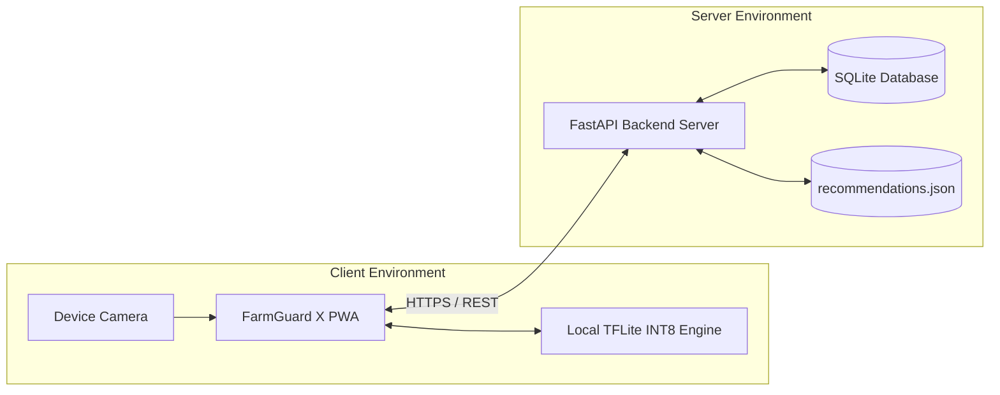

# FarmGuard X — Software Requirements Specification (SRS)

**Document Version**: 1.0.0  
**Standard Compliance**: IEEE Std 830-1998 / ISO/IEC/IEEE 29148  
**Status**: APPROVED BASELINE  
**Product**: FarmGuard X — AI Crop Pathology Platform  
**Author**: Systems Engineering & Machine Learning Quality Assurance  
**Date**: October 2026  

---

## 1. Introduction

### 1.1 Purpose
This document provides a formal Software Requirements Specification (SRS) for **FarmGuard X**. It formally delineates the functional and non-functional requirements, external interfaces, data schemas, mathematical constraints, and verification criteria governing the system.

### 1.2 Scope
FarmGuard X is a digital agricultural diagnostics platform delivering on-device and cloud-assisted crop disease identification and agronomic recovery advisory. The software includes:
* A Progressive Web App client for field image capture and diagnosis presentation.
* A FastAPI REST backend service managing user identity, inference processing, history tracking, and treatment lookups.
* A TensorFlow/Keras ML training pipeline implementing data deduplication, zero-leakage splitting, MobileNetV2 transfer learning, and INT8 post-training edge quantization.

### 1.3 Definitions, Acronyms, and Abbreviations
* **PWA**: Progressive Web Application.
* **INT8**: 8-bit Integer Quantization.
* **TFLite**: TensorFlow Lite edge inference framework.
* **dhash**: Difference Hashing (perceptual gradient image hashing).
* **$H_d$**: Hamming Distance between binary hash vectors.
* **Solanaceae**: The nightshade botanical family, specifically Potato (*Solanum tuberosum*) and Tomato (*Solanum lycopersicum*).
* **JWT**: JSON Web Token (RFC 7519).
* **IPM**: Integrated Pest Management.
* **TYLCV**: Tomato Yellow Leaf Curl Virus.

### 1.4 References
1. IEEE Std 830-1998: *IEEE Recommended Practice for Software Requirements Specifications*.
2. PlantVillage Benchmark Dataset: *Mohanty et al., 2016*. CC BY 4.0.
3. MobileNetV2: *Inverted Residuals and Linear Bottlenecks*, Sandler et al., 2018.
4. FastAPI Technical Documentation (v0.109+), Pydantic v2 Documentation.

---

## 2. Overall Description

### 2.1 Product Perspective
FarmGuard X operates as an independent, modular agricultural diagnostics platform. It does not depend on proprietary third-party cloud AI APIs (e.g. OpenAI, Google Vision), executing all neural inferences using self-trained, self-hosted MobileNetV2 models.

### 2.2 Product Functions (High-Level Summary)
* **Image Acquisition**: Capture, resize, validate, and normalize crop leaf photographs.
* **Pathological Classification**: Multi-class categorization into 8 mutually exclusive Solanaceae disease/healthy classes.
* **Advisory Delivery**: Automated generation of organic and chemical recovery protocols.
* **Identity Management**: Secure user registration, authentication, and session handling.
* **Field History & Telemetry**: Logging of diagnostic scans, confidence scores, and disease incidence rates.

### 2.3 User Characteristics & Operating Constraints
* **Target User**: Farmers, agricultural extension officers, and agronomists.
* **Operating Environment**: Outdoor farm fields with high ambient sunlight, dust, variable cellular connectivity, and budget smartphones (Android 9.0+, minimum 2 GB RAM).

### 2.4 Assumptions and Dependencies
* The client device possesses a functional rear-facing camera sensor ($\ge 2\text{ MP}$ resolution).
* The backend execution environment provides Python 3.11 with OpenCV and TensorFlow dependencies installed.

---

## 3. Specific System Requirements

### 3.1 External Interface Requirements

#### 3.1.1 User Interfaces
* **UI-1 (Responsive Viewport)**: The client shall automatically adapt to screen widths from $320\text{px}$ to $1920\text{px}$.
* **UI-2 (Status Indicator)**: The header shall display a real-time connectivity badge:
  * "🟢 Offline Ready" when Service Worker cache and local assets are active.
  * "🔴 Server Disconnected" when cloud API requests time out.
* **UI-3 (Inspection Card)**: Diagnostic results must present:
  * Crop name and diagnosed disease.
  * Confidence meter percentage.
  * Color-coded Severity tag: Low (Green), Medium (Amber), High/Critical (Red).
  * Tabbed Dual Advisory: "🌿 Organic Treatment" and "🧪 Chemical Treatment".

#### 3.1.2 Hardware Interfaces
* **HW-1 (Camera Access)**: The system shall interface with standard HTML5 MediaDevices API (`navigator.mediaDevices.getUserMedia`) requesting rear-facing camera (`facingMode: "environment"`).

#### 3.1.3 Software Interfaces
* **SW-1 (Database Interface)**: SQLAlchemy 2.0 ORM interfacing with SQLite (`farmguard.db`) using write-ahead logging (WAL) where supported.
* **SW-2 (ML Framework Interface)**: TensorFlow Lite Runtime (C++/Python/WebAssembly) executing quantized FlatBuffer models.

#### 3.1.4 Communication Interfaces
* **COMM-1 (Protocols)**: All client-server communications shall use HTTPS (TLS 1.3) over TCP port 443.
* **COMM-2 (Data Serialization)**: REST API payloads shall be formatted as standard UTF-8 JSON. File uploads shall use standard `multipart/form-data`.

---

### 3.2 Functional Requirements (Detailed Specifications)

#### 3.2.1 Diagnostic Inference Subsystem
* **SRS-FR-01 (Input Resolution)**: The system shall accept images of arbitrary dimensions and preprocess them to exactly $224 \times 224$ pixels in 3-channel RGB format.
* **SRS-FR-02 (Pixel Scaling)**: The preprocessing module shall scale pixel intensities from $[0, 255]$ to the standard MobileNetV2 domain of $[-1.0, 1.0]$ via $x_{\text{norm}} = \frac{x}{127.5} - 1.0$.
* **SRS-FR-03 (Classification Scope)**: The model must output a probability distribution over the exact 8 approved classes:
  $$\mathbf{y} \in \mathbb{R}^8, \quad \sum_{i=0}^7 y_i = 1.0, \quad y_i \ge 0$$
* **SRS-FR-04 (Confidence Gating)**: The system shall evaluate the maximum Softmax probability $p_{\max} = \max(\mathbf{y})$.
  * If $p_{\max} \ge 0.65$, output confirmed diagnosis.
  * If $p_{\max} < 0.65$, output diagnosis accompanied by a low-confidence advisory warning.

#### 3.2.2 Treatment Advisory Subsystem
* **SRS-FR-05 (Advisory Mapping)**: For every valid diagnosis, the system shall retrieve the matching entry from [`recommendations.json`](file:///c:/F/FarmGuard-X/backend/app/data/recommendations.json).
* **SRS-FR-06 (Mandatory Advisory Fields)**: The returned advisory must contain:
  1. `crop`: Crop species.
  2. `disease`: Normalized disease name.
  3. `severity`: Severity categorization (Low / Medium / High).
  4. `organic_treatment`: Non-chemical, biological, or cultural remedy.
  5. `chemical_treatment`: Approved chemical fungicide/bactericide active ingredients and mixing dosage.
  6. `preventive_measures`: List of cultural prophylaxis techniques.
  7. `recovery_time`: Expected recovery or stabilization timeline.

#### 3.2.3 Identity & History Subsystem
* **SRS-FR-07 (Password Encryption)**: Passwords must be hashed using `bcrypt` with a minimum cost factor of 12 before database storage. Plaintext passwords shall never be logged or persisted.
* **SRS-FR-08 (Session Token)**: Authentication shall issue a signed JWT containing `sub` (user email), `exp` (expiration timestamp), and `iat` (issued at).
* **SRS-FR-09 (Scan Logging)**: Every scan performed by an authenticated user shall be logged to the `predictions` table within an active database transaction.

---

### 3.3 Data Engineering & Machine Learning Requirements

* **SRS-ML-01 (Class Balancing)**: Because the raw PlantVillage dataset exhibits a $35:1$ class ratio between TYLCV ($5,357$ images) and Potato Healthy ($152$ images), training loss shall apply inverse-frequency class weights:
  $$w_c = \frac{N_{\text{train}}}{8 \times N_{\text{train}, c}}$$
* **SRS-ML-02 (Zero Data Leakage Assertion)**: The dataset splitting pipeline shall compute difference hashes ($H_d$) for all images. Any image pair with $H_d \le 6$ within the same class must be assigned to the same partition. The following assertions must evaluate to `True`:
  $$\mathcal{S}_{\text{train}} \cap \mathcal{S}_{\text{val}} = \emptyset$$
  $$\mathcal{S}_{\text{train}} \cap \mathcal{S}_{\text{test}} = \emptyset$$
  $$\mathcal{S}_{\text{val}} \cap \mathcal{S}_{\text{test}} = \emptyset$$
* **SRS-ML-03 (Quantization Specification)**: The post-training quantization pipeline shall convert floating-point weights to signed 8-bit integers (`int8`) using symmetric per-channel quantization for weights and asymmetric per-tensor quantization for activations, calibrated across $\ge 200$ representative training images.

---

## 4. Non-Functional Requirements & System Attributes

### 4.1 Performance Requirements
* **SRS-NFR-01 (Edge Inference Speed)**: On an ARM Cortex-A53 mobile CPU, local inference latency must not exceed $150\text{ ms}$.
* **SRS-NFR-02 (Server Latency)**: The FastAPI server `/api/v1/predict` endpoint must respond within $250\text{ ms}$ (excluding network transit).
* **SRS-NFR-03 (Model Size Limit)**: The `.tflite` model file must not exceed $15.0\text{ MB}$.

### 4.2 Security & Privacy Requirements
* **SRS-NFR-04 (Filename Sanitization)**: User uploads must be assigned a random UUIDv4 filename before saving to disk to prevent arbitrary file overwrite attacks.
* **SRS-NFR-05 (File Type Whitelisting)**: Files with magic numbers not matching JPEG or PNG headers must be rejected with HTTP status 415.
* **SRS-NFR-06 (Data Privacy)**: No GPS coordinates or farmer personally identifiable information shall be embedded in model training datasets.

### 4.3 Reliability & Availability Requirements
* **SRS-NFR-07 (Service Availability)**: The backend service shall achieve $\ge 99.5\%$ operational uptime.
* **SRS-NFR-08 (Graceful AI Degradation)**: In the event of missing weight files or uninitialized inference engines, the server must not raise an unhandled 500 error; it must return a fallback diagnostic response with appropriate status logging.

---

## 5. Verification & Acceptance Criteria Matrix

| Requirement ID | Verification Method | Acceptance Criteria | Verified Status |
|:---|:---:|---|:---:|
| **SRS-FR-01** | Unit Test | Preprocessing output tensor shape is exactly `(1, 224, 224, 3)` | ✅ Verified ([`test_loader.py`](file:///c:/F/FarmGuard-X/farmguard_ai/tests/test_loader.py)) |
| **SRS-FR-02** | Unit Test | Pixel values strictly within $[-1.0, 1.0]$ | ✅ Verified ([`test_loader.py`](file:///c:/F/FarmGuard-X/farmguard_ai/tests/test_loader.py)) |
| **SRS-FR-03** | Assertion Test | Output array contains 8 class scores summing to $1.0 \pm 10^{-5}$ | ✅ Verified ([`test_builder.py`](file:///c:/F/FarmGuard-X/farmguard_ai/tests/test_builder.py)) |
| **SRS-FR-07** | Integration Test | Passwords stored as `$2b$...` bcrypt hashes; plaintext match returns `True` | ✅ Verified ([`test_auth.py`](file:///c:/F/FarmGuard-X/backend/tests/test_auth.py)) |
| **SRS-ML-01** | Mathematical Test | $w_c$ calculated strictly from training split; sum of weighted frequencies matches $N_{\text{train}}$ | ✅ Verified ([`test_class_weights.py`](file:///c:/F/FarmGuard-X/farmguard_ai/tests/test_class_weights.py)) |
| **SRS-ML-02** | Audit Test | Zero group intersection across Train, Val, and Test in `split_manifest.csv` | ✅ Verified ([`test_leakage_checker.py`](file:///c:/F/FarmGuard-X/farmguard_ai/tests/test_leakage_checker.py)) |
| **SRS-NFR-03** | Binary Size Audit | Output INT8 `.tflite` model binary size $\le 15.0\text{ MB}$ | 📋 Evaluated in Sprint 3E |
